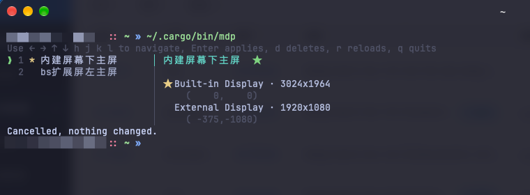

<div align="center">

# multi-display (mdp)

**Save your macOS multi-display layouts and switch them with one key — positions and primary display included.**

[](https://github.com/sparrowx-org/mdp/actions/workflows/ci.yml)
[](https://github.com/sparrowx-org/mdp/releases/latest)
[](LICENSE)
[](https://www.apple.com/macos/)

</div>

**[English](README.md) | [简体中文](README.zh-CN.md)**



Run `mdp`, move with `↓`, press `Enter`. The right pane shows exactly where every
display will end up, and `→` marks the ones that actually move.

The picker renders **inline**: no alternate screen, no clearing. It draws right
under your prompt and stays in the scrollback afterwards, so you can scroll up
and read it later.

---

## Features

- **One key to switch** — run `mdp`, pick with the arrows, press Enter. Nothing else.
- **Primary display included** — macOS defines the primary display as the one at origin `(0,0)`, so switching solutions switches which display is primary. No more dragging the menu bar in System Settings.
- **No permissions** — only **public** CoreGraphics APIs. No Accessibility or Screen Recording prompt.
- **Atomic switch** — the whole layout is committed in one transaction; any failure rolls back, so you never get half a layout.
- **Tells you the truth** — macOS silently removes gaps and overlaps. mdp reads the real positions back afterwards and tells you exactly which display did not land where you wanted.
- **Knows your hardware** — displays are identified by a persistent UUID, so docks, cables and reboots do not confuse it.
- **Scriptable** — every subcommand takes `--json`; outside a TTY `mdp` tells you to use `mdp apply` instead.

## Install

### Homebrew (recommended)

```bash
brew tap sparrowx-org/tap
brew install sparrowx-org/tap/mdp
```

Homebrew taps it for you if you skip the first line:

```bash
brew install sparrowx-org/tap/mdp
```

### curl | sh

```bash
curl -fsSL https://raw.githubusercontent.com/sparrowx-org/mdp/main/install.sh | sh
```

### From source

```bash
git clone https://github.com/sparrowx-org/mdp.git
cd mdp
cargo install --path .
```

> Requires Rust 1.85+. `cargo install mdp` from crates.io will work once published.

## Quick start

```bash
# 1. save the layout you are using right now
$ mdp store work "external as primary, laptop on the right"

# 2. rearrange the displays however you like in System Settings

# 3. switch back whenever you want
$ mdp
```

Solutions live in `~/.config/mdp/solutions.toml` — plain text, safe to put in dotfiles and sync with git.

## Commands

| Command | Description |
| --- | --- |
| `mdp` | Open the interactive picker (arrows to move, Enter to apply) |
| `mdp store <name> [description]` | Save the current layout (add `--force` to overwrite) |
| `mdp list` | List solutions, `*` marks the one currently in use |
| `mdp apply <name>` | Apply a solution (alias `use`) |
| `mdp apply <name> --dry-run` | Show what would change without touching anything |
| `mdp apply <name> --session` | Apply for this login session only, do not persist |
| `mdp current` | Show the current layout |
| `mdp show <name>` | Show one solution in detail |
| `mdp rename <old> <new>` | Rename a solution |
| `mdp delete <name>` | Delete a solution (aliases `rm`, `remove`) |
| `mdp edit` | Open the solution file in `$EDITOR` |
| `mdp path` | Print the solution file path |

Global options: `--config <path>`, `--json`.

### Picker keys

| Key | Action |
| --- | --- |
| `↑` `↓` `←` `→` / `hjkl` | Move the selection |
| `1`–`9` | Select the nth solution and apply it |
| `PageUp` `PageDown` / `Home` `End` | Page / jump to first / last |
| `Enter` | Apply the selected solution |
| `d` | Delete the selected solution (press `d` again to confirm) |
| `r` | Reload the solution file (after editing it elsewhere) |
| `q` / `Esc` / `Ctrl-C` | Cancel, displays untouched |

### Scripting

```bash
$ mdp apply work --json | jq -r '.displays[] | "\(.display) → \(.actual[0]),\(.actual[1])"'
External Display · 1920x1080 → 0,0
Built-in Display · 3024x1964 → 1920,268
```

`--dry-run` JSON describes the intended change with `from`, `to` and `match` — the last one tells you whether the display was matched by UUID or by the size fallback:

```bash
$ mdp apply work --dry-run --json | jq -r '.entries[] | "\(.display): (\(.from[0]),\(.from[1])) \(.match) → (\(.to[0]),\(.to[1]))"'
External Display · 1920x1080: (0,0) uuid → (0,0)
Built-in Display · 3024x1964: (1920,268) uuid → (1920,268)
```

## Solution file

Default location `~/.config/mdp/solutions.toml`, override with `--config` or `$MDP_CONFIG`:

```toml
[[solution]]
name = "work"
description = "external as primary, laptop on the right"
created_at = "2026-10-09T20:21:28+08:00"
updated_at = "2026-10-09T20:21:28+08:00"

[[solution.displays]]
uuid = "F425DECB-68B1-4C44-A90E-E38EEE5257E4"
name = "External Display"
x = 0            # global coordinates, origin = top-left of the primary display
y = 0
width = 1920     # logical size (points)
height = 1080
pixel_width = 1920
pixel_height = 1080
builtin = false
primary = true   # ★ this one is the primary display

[[solution.displays]]
uuid = "37D8832A-2D66-02CA-B9F7-8F30A301B230"
name = "Built-in Display"
x = 1920
y = 268
width = 1512
height = 982
pixel_width = 3024
pixel_height = 1964
builtin = true
primary = false
```

Solutions are an array of tables rather than a map, so **the order in the file is the order in `mdp list`** — reorder them by editing the file. Writes are atomic (temp file, then `rename`), so a power cut cannot corrupt it.

> Dropping optional fields such as `description` or `updated_at` is fine.

## How it works

Displays are keyed by the persistent UUID from `CGDisplayCreateUUIDFromDisplayID`. The `CGDirectDisplayID` (that little `1` / `3` integer) changes on every boot and every replug and must never be used as a key.

Switching layouts is a single transaction:

```
CGBeginDisplayConfiguration
  → CGConfigureDisplayOrigin(primary, 0, 0)   ← the display at origin (0,0) *is* the primary
  → CGConfigureDisplayOrigin(other, x, y)
CGCompleteDisplayConfiguration(kCGConfigurePermanently)
```

- The primary display must be sent **first**: the global coordinate origin follows the primary, so moving the others first would shift everything.
- Any failing configuration call triggers `CGCancelDisplayConfiguration`, rolling the whole thing back.
- `kCGConfigurePermanently` makes the layout survive reboots and logins.
- After committing it sleeps 120ms and reads the positions back — the window server applies changes asynchronously, so a successful call does not mean a successful layout.

**Only positions and the primary display are stored — never resolution or refresh rate.** Switching resolution carries far more risk than value; use System Settings for that. The stored `pixel_width` / `pixel_height` exist solely to re-identify a display when its UUID no longer matches.

## Known limitations

- **macOS removes gaps and overlaps on its own.** Saved layouts never have gaps, but if the requested spot does not fit, the system puts the display as close as it can. mdp reads the real result back and tells you which display did not land where you wanted, instead of pretending it worked.
- **Mirrored displays are not positioned.** In mirror mode a display's position follows its source, so mdp skips it and warns. Setting the origin of a non-source display removes it from the mirror set automatically — that is documented CoreGraphics behaviour.
- **Display product names are unavailable.** On Apple Silicon, `CGDisplayCreateDisplayFromIOKitPort` has been removed from CoreGraphics and the `IODisplayConnect` class is no longer registered, so names can only be `Built-in Display` / `External Display` (numbered when there is more than one). Resolution and UUID tell them apart.
- **UUID fallback:** if a UUID does not match, mdp falls back to matching by pixel size plus built-in/external. It only accepts a **unique** candidate; with several same-sized displays it reports the ambiguity and skips rather than guessing wrong. Re-store the solution to fix it.
- **Sleeping displays are not configured**, only skipped with a warning.
- Requires macOS 11+.

## Development

```bash
cargo test                                              # matching logic + TOML round-trip
cargo clippy --all-targets -- -D warnings
cargo fmt --all
mise run check                                          # test + lint
```

| File | Responsibility |
| --- | --- |
| `src/cg.rs` | CoreGraphics / CoreFoundation FFI, public APIs only |
| `src/model.rs` | `Solution` / `Placement` data model and validation |
| `src/store.rs` | solution file IO (atomic writes, path resolution) |
| `src/apply.rs` | matching solutions to displays, applying layouts, read-back verification |
| `src/tui.rs` | inline two-pane picker (crossterm) |
| `src/cli.rs` | clap command definitions |

After changing the build config, run `cargo dist generate` to sync the release workflow. See [RELEASING.md](RELEASING.md) for the release process.

## Uninstall

```bash
brew uninstall mdp        # or brew untap sparrowx-org/tap
```

Your solution file is left alone at `~/.config/mdp/solutions.toml`; remove it yourself if you want.

## License

[MIT](LICENSE)
